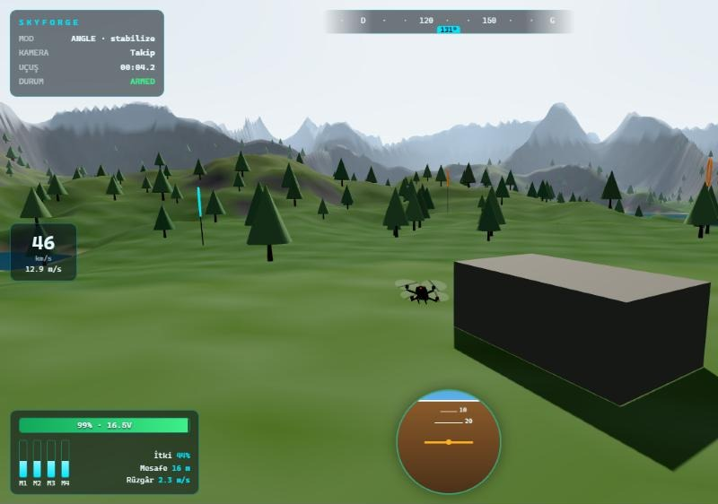
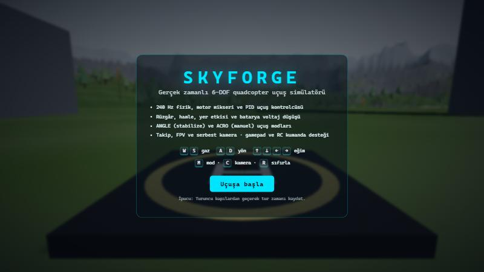
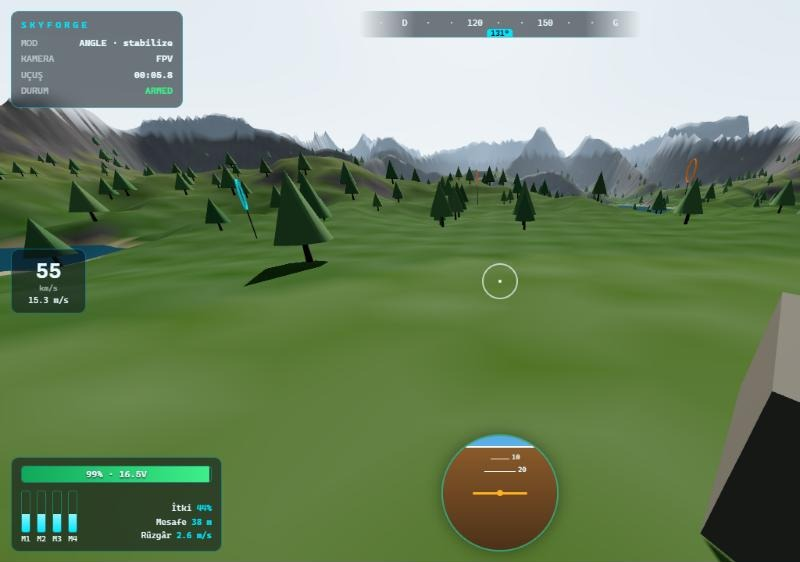
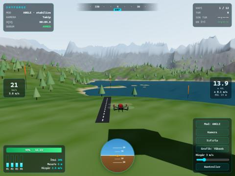
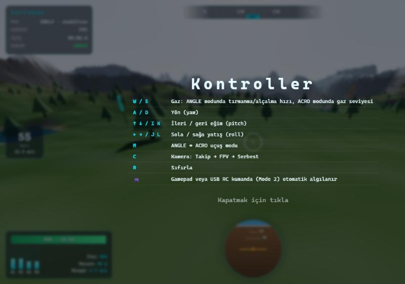

<div align="center">

# 🛸 SkyForge

**Tarayıcıda çalışan, gerçekçi 6-DOF quadcopter uçuş simülatörü**

[](https://skyforge-gold.vercel.app)




</div>

## ✨ Özellikler

- **240 Hz sabit adımlı fizik**: 4 motorlu mikser, motor doygunluğu ve spin-up gecikmesi, jiroskopik etkiler
- **PID uçuş kontrolcüsü**: Kaskad açı → açısal hız kontrolü
- **İki uçuş modu**
  - `ANGLE`: Kendini dengeler, gaz çubuğu tırmanma hızını belirler (bırakınca havada asılı kalır)
  - `ACRO`: Tamamen manuel, FPV yarış drone'u hissi
- **Çevre etkileri**: İrtifaya göre artan rüzgâr ve hamleler, yer etkisi, açıya bağlı aerodinamik sürükleme
- **Batarya modeli**: Güç tüketimi, voltaj düşüşü ve azalan itki
- **Prosedürel dünya**: Dağlar, göl, 2200+ ağaç (instanced), hangar, kule, pist
- **Çarpışma ve kaza**: Arazi, yapılar, ağaçlar ve su; sert iniş algılama
- **Yarış parkuru**: 12 kapı, tur süresi, en iyi tur (localStorage)
- **3 kamera**: Takip · FPV (18° uptilt, 100° FOV) · Serbest yörünge
- **Giriş**: Klavye, gamepad, USB RC kumanda (Mode 2), mobilde dokunmatik çubuklar
- **HUD**: Yapay ufuk, pusula, hız/irtifa göstergeleri, motor çıkışları, batarya voltajı
- **Veritabanı yok**: Tamamen istemci tarafında çalışır, statik olarak deploy edilir

## 📸 Ekran Görüntüleri

| Başlangıç | FPV Kamera |
|---|---|
|  |  |
| **Göl ve dağlar** | **Kontroller** |
|  |  |

## 🎮 Kontroller

| Tuş | İşlev |
|---|---|
| `W` / `S` | Gaz (ANGLE: tırmanma hızı · ACRO: gaz seviyesi) |
| `A` / `D` | Yön (yaw) |
| `↑` `↓` / `I` `K` | İleri / geri eğim (pitch) |
| `←` `→` / `J` `L` | Sola / sağa yatış (roll) |
| `M` | ANGLE ↔ ACRO |
| `C` | Kamera değiştir |
| `R` | Sıfırla |
| `H` | Kontrol yardımı |

## 🚀 Kurulum

```bash
git clone https://github.com/enescivelek0/skyforge.git
cd skyforge
npm install
npm run dev
```

Üretim derlemesi: `npm run build` (çıktı `dist/`).

## 🧠 Mimari

```
src/
├── sim/
│   ├── physics.ts     # Rijit cisim dinamiği, mikser, PID, batarya, çarpışma, kapılar
│   ├── input.ts       # Klavye / gamepad / dokunmatik → yumuşatılmış, expo eğrili girişler
│   ├── terrain.ts     # Deterministik simplex-noise arazi (mesh ve fizik aynı fonksiyonu kullanır)
│   └── worldData.ts   # Yapılar, ağaçlar, yarış kapıları
├── components/
│   ├── SimLoop.tsx    # Sabit zaman adımlı döngü, kamera sistemi, HUD telemetrisi (15 Hz)
│   ├── World.tsx      # Gökyüzü, arazi, su, instanced ağaçlar, drone'u takip eden gölge kamerası
│   ├── Drone.tsx      # Quadcopter modeli, dönen pervaneler ve LED'ler
│   └── HUD.tsx        # Arayüz, yapay ufuk, dokunmatik çubuklar
└── store.ts           # Zustand durum yönetimi
```

Fizik durumu React dışında tutulur: Simülasyon `useFrame` içinde 240 Hz'de ilerler, arayüz ise yalnızca 15 Hz'de güncellenir. Böylece React yeniden çizimleri fizik döngüsünü yavaşlatmaz.

## 🛣️ Yol Haritası

- [ ] Otonom waypoint görev modu
- [ ] Uçuş kaydı ve CSV dışa aktarma
- [ ] Hayalet (ghost) tur tekrarı
- [ ] Canlı PID ayar paneli
- [ ] Gündüz / gece döngüsü

## 📄 Lisans

MIT
